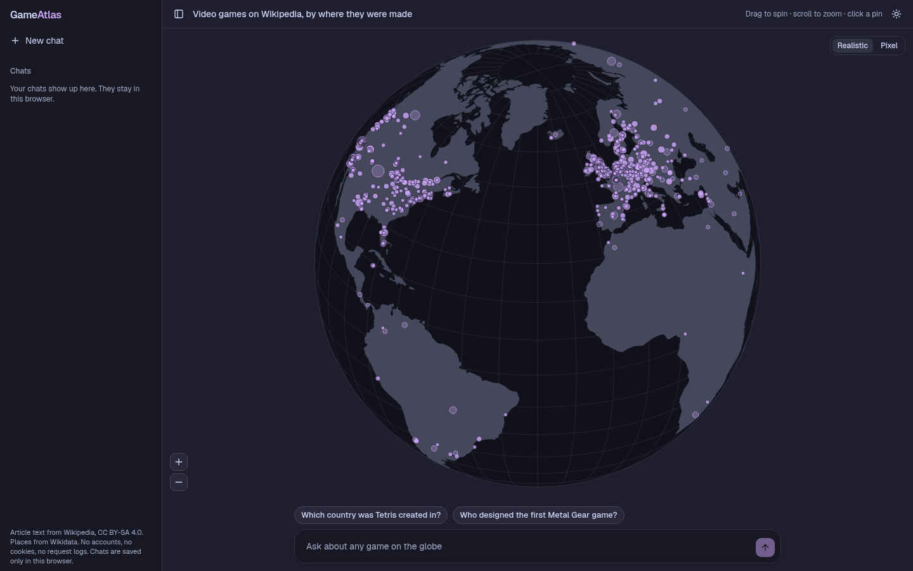
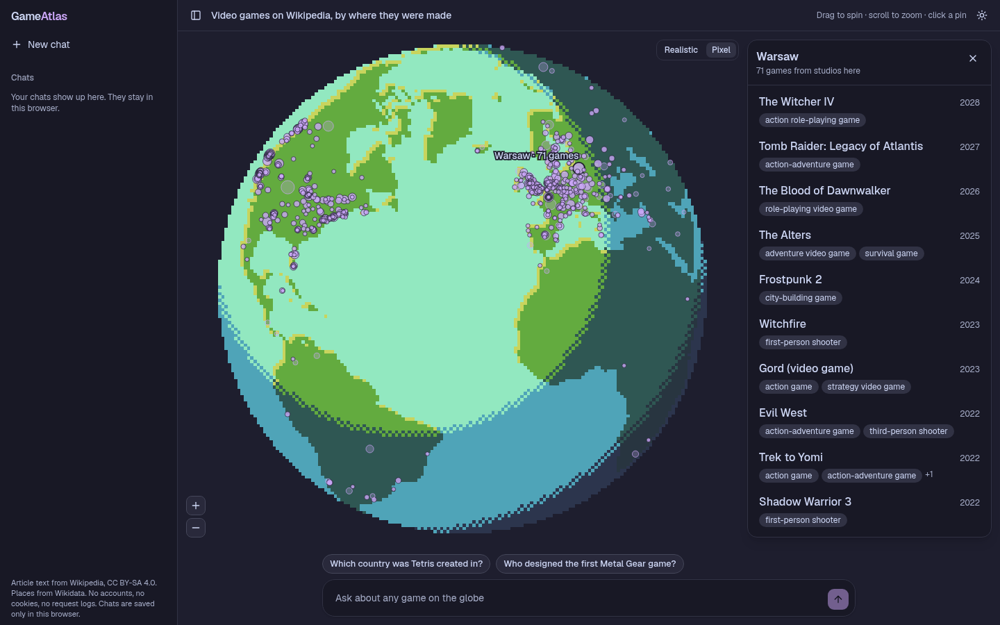
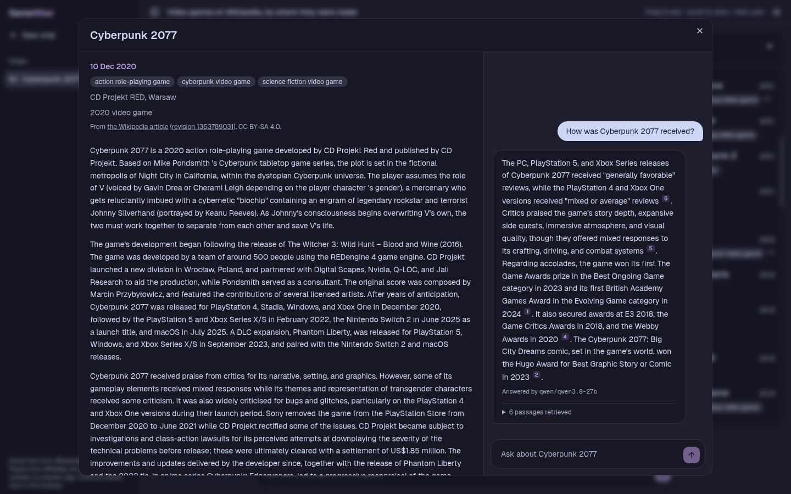
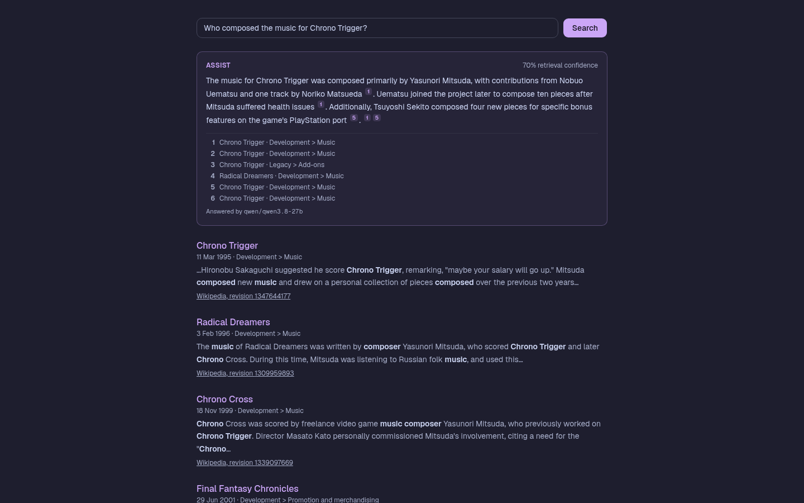

# rag-ai-chat

Explore Wikipedia's video game articles on a globe of the studios that made them, and ask questions that are answered only from those articles, with numbered citations. No accounts, no cookies, no request logs.



**Headline numbers**, measured on a 2-core VPS; load runs use the mock provider:

- **Provider outage:** errors fall from 26.3% to 0 with a per-provider circuit breaker and a 2 s first-token deadline. [Outage table](#outage)
- **Answer cache:** time to first token p50 drops from 409 ms to 9 ms on Zipf traffic, and 61% of chats are answered without calling a model. [Cache table](#answer-cache)
- **Dense retrieval:** hit@5 0.806 against BM25's 0.669, at a retrieval p99 of 183 ms. [Retrieval table](#retrieval)
- **Steady load:** 4 chats/s for 60 s with dense retrieval, 0 errors and a 176 ms p50 time to first token. [Load table](#steady-load)

**What it does:**

- **Explore** 24,887 games with article text on a globe, drawn realistic or as pixel art, in light or dark mode. Each pin is a studio's headquarters city; games whose studio city isn't on Wikidata sit on their country instead. Click a pin to list its games with genre and release year.
- **Read** a game's article in a dialog, linked to the exact Wikipedia revision it came from.
- **Ask** about that one game beside its article, or about every game from the main chat box. Each answer streams with `[n]` citations that open the passage they came from, and names the model that wrote it. Past chats are listed in the sidebar and saved only in the browser.
- **Search** the articles at `/search`: up to 10 games, each with its best-matching passage and the matched words highlighted. When the top results clearly answer the query, a cited AI answer streams above them; otherwise the page says so, shows its retrieval confidence, and lists the results alone.

<p>
  <a href="assets/screenshots/place-pixel.png"></a>
  <a href="assets/screenshots/game-chat.png"></a>
  <a href="assets/screenshots/search-assist.png"></a>
</p>

## Numbers

Measured on a 2-core VPS. Reproduce with the commands in [Evals and load](#evals-and-load).

| Corpus                                                                                                     |         |
| ---------------------------------------------------------------------------------------------------------- | ------- |
| Video games with an English Wikipedia article and a country of origin (P495, else the developer's country) | 26,937  |
| With article text                                                                                          | 24,887  |
| With a release date (Wikidata P577)                                                                        | 25,638  |
| With a studio city (developer's HQ, P178 → P159)                                                           | 16,306  |
| With a genre (P136)                                                                                        | 25,221  |
| Passages                                                                                                   | 162,346 |

<a id="retrieval"></a>

| Retrieval eval: 160 frozen questions (HotpotQA, KILT NQ, hand-written) | BM25         | dense (default) | hybrid, RRF k=60 |
| ---------------------------------------------------------------------- | ------------ | --------------- | ---------------- |
| hit@5                                                                  | 0.669        | 0.806           | 0.806            |
| hit@20                                                                 | 0.825        | 0.925           | 0.925            |
| MRR                                                                    | 0.510        | 0.666           | 0.624            |
| Article recall@20                                                      | 0.863        | 0.897           | 0.912            |
| Retrieval p50 / p99                                                    | 210 / 418 ms | 79 / 183 ms     | 292 / 502 ms     |
| hit@5, multi-hop (56, mostly HotpotQA bridge)                          | 0.839        | 0.821           | 0.929            |
| hit@5, single-hop (104, NQ and hand-written)                           | 0.577        | 0.798           | 0.740            |

| Answer eval: 180 frozen questions through BM25 retrieval + `GroundedChat`, `mock-extractive` | all       | HotpotQA  | KILT NQ   | hand-written |
| -------------------------------------------------------------------------------------------- | --------- | --------- | --------- | ------------ |
| A gold passage is among the 6 sent                                                           | 0.681     | 0.836     | 0.507     | 0.833        |
| Answer contains a gold answer                                                                | 0.356     | 0.400     | 0.240     | 0.567        |
| Answer token F1                                                                              | 0.027     | 0.024     | 0.020     | 0.048        |
| Citation precision (cited passages holding gold evidence)                                    | 0.308     | 0.345     | 0.200     | 0.506        |
| Citation recall (gold articles cited)                                                        | 0.694     | 0.527     | 0.727     | 0.917        |
| Citation validity / uncited sentences / lexical faithfulness                                 | 1 / 0 / 1 | 1 / 0 / 1 | 1 / 0 / 1 | 1 / 0 / 1    |
| Says "not covered" on the 20 unanswerable questions                                          | 0.200     |           |           | 0.200        |
| Says "not covered" on an answerable question                                                 | 0.006     | 0         | 0.013     | 0            |

The extractive mock quotes retrieved sentences verbatim and cites each one, so citation validity, uncited sentences, and lexical faithfulness sit at their ceilings by construction. They are there to catch a real model. Token F1 is low because the mock answers with whole sentences, not short spans. `EVAL_JUDGE=anthropic` adds a claim-by-claim LLM judge for faithfulness. [`AnswerMetrics.ts`](src/evals/AnswerMetrics.ts), [`FaithfulnessJudge.ts`](src/evals/FaithfulnessJudge.ts)

<a id="steady-load"></a>

| Load: 4 chats/s for 60 s, production build, mock provider | BM25                   | dense (default)    | hybrid                      |
| --------------------------------------------------------- | ---------------------- | ------------------ | --------------------------- |
| Errors                                                    | 0                      | 0                  | 0                           |
| Time to first token p50 / p95 / p99                       | 799 / 6,872 / 7,578 ms | 176 / 211 / 411 ms | 12,973 / 35,262 / 35,472 ms |
| Server resident memory after the run                      | 228 MB                 | 511 MB             | 520 MB                      |

| Dense index          |                                                                                |
| -------------------- | ------------------------------------------------------------------------------ |
| Model                | snowflake-arctic-embed-xs, int8 ONNX (23 MB), 384 dimensions                   |
| Vectors              | 162,346 × 384 int8 + one scale each: 64 MB in memory, 92 MB added to SQLite    |
| Load at startup      | about 1 s                                                                      |
| Embedding the corpus | 84 passages/s alone; 1 h 37 min for all of them at `nice 19` beside other jobs |

<a id="answer-cache"></a>

| Load: 2 chats/s for 90 s, production build, mock provider, full BM25  | before the answer cache | with it                     |
| --------------------------------------------------------------------- | ----------------------- | --------------------------- |
| Zipf (s = 1 over 180 questions): time to first token p50 / p95 / p99  | 409 / 1,100 / 1,303 ms  | 9 / 565 / 890 ms            |
| Zipf: total p50 / p99                                                 | 4,406 / 10,269 ms       | 10 / 4,513 ms               |
| Zipf: answered without calling a model                                | 0%                      | 61% (109 hits, 1 coalesced) |
| Uniform (180 distinct questions): time to first token p50 / p95 / p99 | 291 / 902 / 1,024 ms    | 284 / 1,056 / 1,360 ms      |
| Errors                                                                | 0                       | 0                           |

<a id="outage"></a>

| Outage: 4 chats/s for 60 s, production build; the primary hangs at 15 s, fails at 30 s, recovers at 45 s | before: retry every request | circuit breaker + 2 s first-token deadline       |
| -------------------------------------------------------------------------------------------------------- | --------------------------- | ------------------------------------------------ |
| Errors                                                                                                   | 26.3%, all stuck past 30 s  | 0                                                |
| While the primary hangs (15–30 s)                                                                        | 59 of 60 requests stuck     | all answered; TTFT p50 3.4 s for 5 s, then 0.2 s |
| While the primary fails (30–45 s), TTFT p50 per 5 s                                                      | 1.4–2.3 s                   | 0.16–0.18 s                                      |
| Back on the primary after it recovers                                                                    | at once                     | after the 10 s cooldown                          |

## How it works

```text
Wikidata SPARQL ──► 26,937 games: country of origin ──► UN M49 region
               └──► earliest release date (P577), kept at its precision
wikimedia/structured-wikipedia ──► sections ──► passages (≤ 400 tokens) ──► SQLite + FTS5
passages ──► arctic-embed-xs on CPU ──► int8 vector per passage ──► SQLite

question + scope (region, years, or one game)
  ──► anonymous session check and rate limit
  ──► answer cache: replay a cached answer, or join one still streaming
  ──► nearest passage vectors in scope (top 6); or BM25, or both fused with RRF
  ──► Citations event ──► model stream ──► Delta events ──► Done { model }
```

- **Corpus.** [`src/corpus`](src/corpus) and [`scripts/corpus`](scripts/corpus) build `data/corpus/games.sqlite`. Wikidata picks the games, their countries of origin, their developers' headquarters cities, and their genres. A headquarters that is a whole country is dropped, so the game falls back to its country pin. UN M49 turns a country into a region. Wikimedia's pre-parsed `structured-wikipedia` dump supplies the text, joined on Wikidata QID, so renames and redirects don't matter.
- **Release dates** keep the precision Wikidata states, so a game known only by year shows "1985", not "1 Jan 1985". Truncated ISO dates sort correctly as plain strings.
- **Retrieval** is dense by default. [snowflake-arctic-embed-xs](https://huggingface.co/Snowflake/snowflake-arctic-embed-xs) embeds the heading and the first 256 tokens of each passage (the whole passage for 65% of them; 128 tokens would cut 69%). Each vector is stored as int8 with one scale, which moves a unit dot product by under 0.01 in the tests. At startup every vector loads into one 64 MB matrix. A question is embedded with the model's query prefix and ranked by an exact brute-force dot product over the passages in scope: 162k × 384 takes about 70 ms in JavaScript, so there is no ANN index to tune or keep in sync. [`DenseIndex.ts`](src/server/search/DenseIndex.ts)
- **BM25** in SQLite FTS5 (porter stemming, diacritics folded) is still there with `RETRIEVAL_MODE=bm25`. `hybrid` fuses the BM25 and dense top 50 with reciprocal rank fusion. Hybrid wins multi-hop questions, where exact names matter, but runs BM25's full scan on every chat and saturates the server at 4 chats/s, so it is opt-in. [`Retriever.ts`](src/server/search/Retriever.ts)
- **Grounded chat** sends the retrieved passages first, then streams the answer. When nothing in scope matches, it says so without calling a model. [`GroundedChat.ts`](src/server/chat/GroundedChat.ts)
- **Search and assist.** `/search` renders on the server and always ranks with BM25, whatever `RETRIEVAL_MODE` says. It takes the top 60 passages, keeps the best one per game, and shows up to 10 with highlighted snippets. An assist gate then scores how clearly those results answer the query from four signals: the top passage's score, its lead over the best passage from any other game, the share of query words it matches, and how many of the top 6 passages come from the same game. Each is scaled to 0–1 and they are averaged. At 0.7 or above, the browser sends the query to the grounded chat, which retrieves for itself, and streams its cited answer above the results; below that, the page makes no model call. [`AssistGate.ts`](src/server/search/AssistGate.ts), [`SearchResults.ts`](src/server/search/SearchResults.ts)
- **Failover.** Providers form an Effect `ExecutionPlan`. A provider that fails, or sends no token within `FIRST_TOKEN_TIMEOUT` (2 s), hands over to the next; once tokens have streamed, a failure is reported rather than restarted. A per-provider circuit breaker opens after 5 consecutive failures or half the calls in 30 s, and requests then skip that provider without calling it. After 10 s one probe goes through, and a success closes it. The last provider in the plan is never cut off, since nothing is left to fail over to. State is in memory, per process, and labeled only by provider. [`CircuitBreaker.ts`](src/server/provider/CircuitBreaker.ts)
- **Answer cache.** A first-turn question is keyed by an HMAC of the normalized question (NFKC, case, spacing, end punctuation), its scope, the model that answers it, the configured models, and the corpus version. Identical questions in flight share one upstream stream: a late joiner replays what was sent, then follows the live tail, and the stream finishes even if the client that started it leaves. Only complete answers written by that model without a provider failure are kept, in an LRU of 1,000 entries for 10 minutes. It wraps `GroundedChat` as a layer. [`AnswerCache.ts`](src/server/chat/AnswerCache.ts)
- **Metrics.** `GET /api/metrics` serves Prometheus text from Effect `Metric`: time to first token, retrieval latency, cache hits, misses and coalesced joins, chat outcomes, and answers by model. [`GatewayMetrics.ts`](src/server/metrics/GatewayMetrics.ts)
- **Providers.** With no keys, the only provider is `mock-extractive`, which quotes the best-matching retrieved sentences with citations. Dev, tests, and load tests never spend money. With `ANTHROPIC_API_KEY`, Claude Haiku 5.5 answers at low effort. With `OPENAI_MODEL`, any OpenAI-compatible endpoint joins the plan: OpenAI, Groq, Together, or a local Ollama. The mock is always the last fallback. `GET /api/models` lists the configured models in fallback order, and a chat may pick one with `model`: it goes first, and the rest stay as fallback. [`ChatModels.ts`](src/server/provider/ChatModels.ts)
- **Provider budget.** The OpenAI-compatible provider can be held under a free tier's limits: requests and tokens, per minute and per day. Each limit is a token bucket that refills continuously, and a chat is sent only if every bucket has room for it. It reserves the prompt, estimated at 3 bytes per token (Groq counted 3.7 to 5 on corpus prompts), plus the full 1,024-token answer allowance, so the estimate runs high. A chat over budget skips the provider without calling it and the next one answers; the circuit breaker does not count that as a failure. State is in memory, per process, so a restart starts with full buckets. [`ProviderBudget.ts`](src/server/provider/ProviderBudget.ts)

## Privacy

- **No identity.** Rate limits use anonymous session tokens: 128 random bits and an expiry, signed with HMAC. The browser holds the token in memory, not in a cookie, and it expires after 30 minutes.
- **Chats stay on the device.** The sidebar's chat history lives in the browser's `localStorage`. The server never receives the list.
- **No logs.** Nothing logs or stores an IP, user agent, token, or question. Lint rejects code that reads identifying headers.
- **Bounded abuse.** Each token gets 10 chats a minute. Global caps on chats and on new tokens bound abuse without knowing who anyone is.
- **Shared cache, not personal.** The cache never sees the session token or headers. Its keys are HMACs under a per-process secret, so a leaked key can't be checked against guessed questions. Hits still count against the rate limit.
- **Aggregate metrics.** Metric labels come from a fixed set (`outcome`, `result`, `model`) with bounded values. A test checks that no question or token reaches `/api/metrics`. Set `METRICS_TOKEN` to require it as a bearer token.
- **Clean errors.** Provider errors never echo the question back to the client. A test checks this.

## Pro without identity

Paying for Pro should not make you identifiable. Pro access uses RSA blind signatures ([RFC 9474](https://www.rfc-editor.org/rfc/rfc9474), variant RSABSSA-SHA384-PSS-Deterministic), the same idea as Privacy Pass.

1. **Get credentials.** On [`/pro`](src/app/pro/page.tsx) you paste an access code. Your browser makes 10 random 32-byte messages and blinds each one by multiplying in a random factor only it knows. It sends the code and the blinded messages. The server checks the code, signs the blinded messages, and returns the signatures. It never sees the real messages.
2. **Unblind.** The browser removes its factors, which leaves ordinary RSA-PSS signatures on the real messages. It checks each one against the published key and keeps them in `localStorage`.
3. **Spend one per session.** When the chat needs a new session, the browser sends one message and its signature to `POST /api/session`. The server checks the signature, records a hash of the message so it can't be used twice, and returns a session token marked `pro`: 60 chats a minute instead of 10, under its own global cap.

The server sees a code and some blinded numbers at step 1, and a message and a signature at step 3. Every blinded number it ever signed matches every credential it is shown equally well, so it can't tell whose credential it is. A test checks exactly this.

```text
Browser                                   Server
   │  GET /api/pro/keys                      │
   │◄──────────────── key id, public key ─────│  key id = SHA-256(SPKI)
   │  m₁…m₁₀ random; bᵢ = blind(mᵢ, rᵢ)       │
   │  POST /api/pro/credentials              │
   │  { code, key id, b₁…b₁₀ } ──────────────►│  check code, quota per code
   │◄──────────────────────── s'₁…s'₁₀ ───────│  s'ᵢ = bᵢ^d mod n
   │  sᵢ = finalize(s'ᵢ, rᵢ); verify          │
   │                                          │
   │        … later, any number of sessions … │
   │  POST /api/session { key id, mᵢ, sᵢ } ──►│  verify; SHA-256(mᵢ) not spent → record it
   │◄──────────────── token (tier: pro) ──────│
```

| Variable                  | Default               | Effect                                                                                    |
| ------------------------- | --------------------- | ----------------------------------------------------------------------------------------- |
| `PRO_ACCESS_CODES`        | unset (no Pro access) | Comma-separated dev access codes. Stands in for a billing check.                          |
| `PRO_SIGNING_KEY`         | random 2048-bit key   | PEM RSA private keys, newest first. The first one signs; all of them verify.              |
| `PRO_SIGNING_KEY_EXPIRES` | 7 days from start     | One ISO date per key, comma-separated. Credentials stop verifying after their key's date. |

`bun run bench:pro` times each step.

## Run it

Requires Bun 1.3 and Node 24.

```sh
bun install
bun run corpus:build         # about 20 minutes and 37 GB streamed; keeps a 300 MB SQLite file in data/
bun run corpus:embed         # downloads the 23 MB model, embeds every passage; resumable, 30 to 100 minutes on 2 cores
bun run dev                  # http://localhost:3000
```

| Environment variable                                    | Default                     | Effect                                                                                              |
| ------------------------------------------------------- | --------------------------- | --------------------------------------------------------------------------------------------------- |
| `ANTHROPIC_API_KEY`                                     | unset                       | Unset: the free extractive mock answers. Set: Claude answers.                                       |
| `ANTHROPIC_MODEL`                                       | `claude-haiku-5-5`          | Model used when a key is set                                                                        |
| `OPENAI_MODEL`                                          | unset                       | Set: an OpenAI-compatible model joins the plan, e.g. `gpt-5-mini` or `llama3.2:3b`                  |
| `OPENAI_BASE_URL`                                       | `https://api.openai.com/v1` | e.g. `https://api.groq.com/openai/v1` or `http://localhost:11434/v1` for Ollama                     |
| `OPENAI_API_KEY`                                        | unset                       | Bearer key for that endpoint; Ollama needs none                                                     |
| `OPENAI_REQUESTS_PER_MINUTE`, `OPENAI_REQUESTS_PER_DAY` | unset                       | Request budget for that endpoint, e.g. `30` and `1000` for Groq's free tier. Unset: no limit        |
| `OPENAI_TOKENS_PER_MINUTE`, `OPENAI_TOKENS_PER_DAY`     | unset                       | Token budget for that endpoint, e.g. `8000` and `200000` for Groq's free tier. Unset: no limit      |
| `FIRST_TOKEN_TIMEOUT`                                   | `2 seconds`                 | How long a provider may take to send its first token before the next one takes over                 |
| `MOCK_PRIMARY`                                          | unset                       | e.g. `ok@15,hang@15,outage@15,ok`: a scheduled mock ahead of the others, for load tests             |
| `RETRIEVAL_MODE`                                        | `dense`                     | `dense`, `bm25`, or `hybrid`. Without embeddings, `dense` and `hybrid` use `bm25` and log a warning |
| `RETRIEVAL_COMMON_WORD_SHARE`                           | unset                       | e.g. `0.1`: every BM25 match needs a word found in under 10% of passages (faster)                   |
| `EMBEDDING_MODEL_DIRECTORY`                             | `data/models`               | Where `corpus:embed` put the model; the server never downloads it                                   |
| `SESSION_SECRET`                                        | random per process          | HMAC key for session tokens; set it when running more than one process                              |
| `CORPUS_DATABASE`                                       | `data/corpus/games.sqlite`  | Corpus location                                                                                     |
| `METRICS_TOKEN`                                         | unset                       | Set: `/api/metrics` requires it as a bearer token                                                   |

## Evals and load

```sh
bun run evals:check          # every frozen question still resolves to passages in the corpus
bun run evals:retrieval      # hit@k, article recall, MRR, latency; writes evals/games/results/retrieval.json
bun run evals:answers        # answer, citation, faithfulness and abstention metrics; writes evals/games/results/answers.json
bun run evals:answers --check  # fails if any metric drops more than 0.02 in a group of 20+ questions
EVAL_PROVIDER=anthropic EVAL_LIMIT=30 bun run evals:answers --estimate  # cost ceiling for a real-model run, no calls made
bun run build && bun run start &
LOAD_BASE_URL=http://localhost:3000 LOAD_RPS=4 LOAD_SECONDS=60 bun run load:steady
LOAD_BASE_URL=http://localhost:3000 LOAD_RPS=2 LOAD_SECONDS=90 bun run load:zipf   # LOAD_ZIPF_EXPONENT=1, LOAD_SEED=1
MOCK_PRIMARY=ok@15,hang@15,outage@15,ok bun run start &   # restart with a misbehaving primary
LOAD_BASE_URL=http://localhost:3000 bun run load:outage   # per-5 s buckets: errors, TTFT, which model answered
LOAD_BASE_URL=http://localhost:3000 bun run load:spike    # 4 chats/s with a 10 s burst at 5x
```

The Go load generator in `loadgen/` sends the same chats from one static binary (`bun run load:go` builds it):

```sh
bun run load:go steady -url http://localhost:3000 -rate 4 -duration 60s   # same traffic as load:steady
bun run load:go steady -url http://localhost:3000 -rate 4 -poisson -seed 7   # exponential gaps, reproducible
bun run load:go spike -url http://localhost:3000 -rate 4 -multiplier 5 -spike-at 20s -spike-for 10s
bun run load:go zipf -url http://localhost:3000 -rate 4 -s 1.1 -seed 7   # question k is asked with weight 1/k^s
bun run load:go steady -url http://localhost:3000 -json > run.json   # summary and 5 s buckets as JSON
```

It is an open-model generator: every chat fires at its scheduled time whether or not earlier ones have finished, and time to first token (the first `Delta` event) and total time are measured from that scheduled time. That corrects for coordinated omission, where a stalled server or a full client quietly delays sends and hides the wait. The report prints the naive from-send timings and the send lag next to the corrected ones. `-max-inflight N` caps concurrency like a fixed connection pool, which is where the two diverge. Errors are split into HTTP status, `Failed` events, timeouts and transport errors. Percentiles come from sorting every sample, which is exact and cheap for a few thousand chats. Each session token carries at most 8 chats a minute, under the gateway's limit of 10, and a new one is minted only when every token is spent. The outage scenario is `steady` against a server started with `MOCK_PRIMARY` from the failover change; the `models` line shows which model answered.

## Checks

`bun run check` runs Prettier, ESLint (strict type-checked rules, plus project rules: no comments, no reading identifying headers, no real time in tests), `tsc` with the Effect language service, and the Vitest suite. CI runs the same checks plus `next build` on every push and pull request. Tests use an in-memory SQLite corpus, `TestClock`, and the mock provider, and they fail if anything tries to reach the network.

## Licensing

Article text is from Wikipedia under CC BY-SA 4.0. Every game page links the revision it shows. Wikidata statements are CC0. Region names are from the UN M49 standard. The code is MIT licensed (see [LICENSE](LICENSE)); the article text it serves stays under CC BY-SA 4.0.
